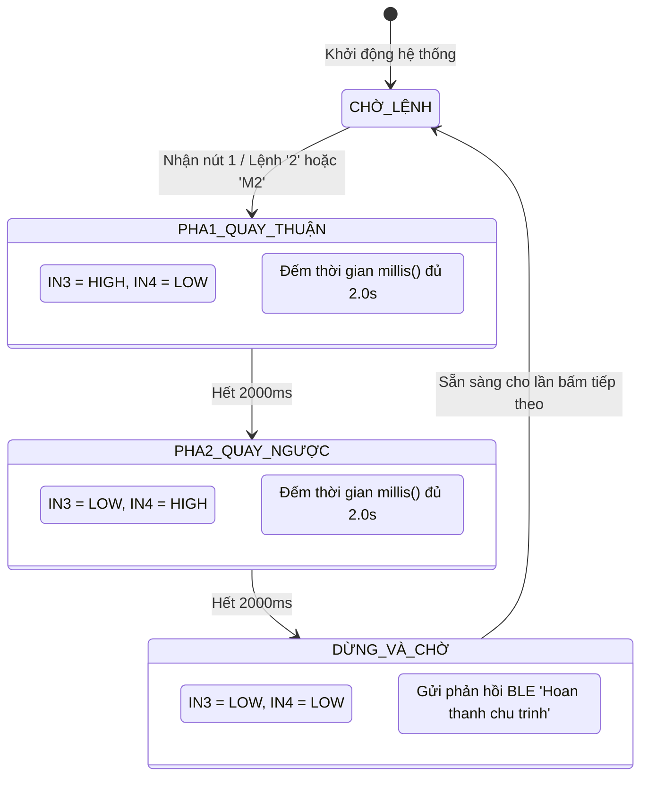
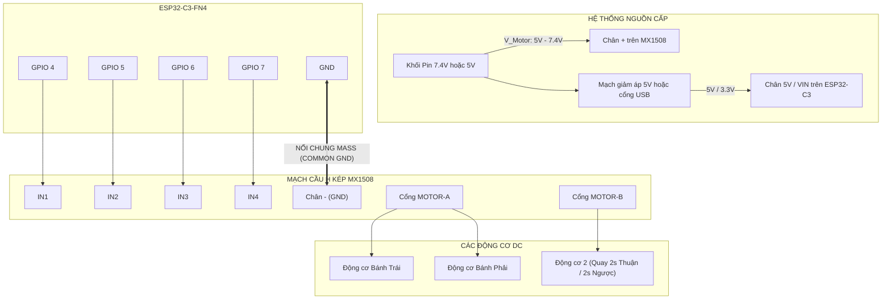

# SƠ ĐỒ MÔ HÌNH MẠCH VÀ KẾT NỐI PHẦN CỨNG
**Dự án:** Điều khiển 2 động cơ độc lập qua Bluetooth Low Energy (Adafruit Bluefruit LE Connect)  
**Vi điều khiển:** ESP32-C3-FN4 (Flash 4MB)  
**Mạch công suất hỗ trợ:** 
1. **MX1508** (Driver cầu H kép mini, gọn nhẹ cho xe nhỏ)
2. **L298N** (Driver cầu H kép tải cao, có tích hợp IC hạ áp 5V nuôi ESP32)

---

## 1. MÔ HÌNH MẠCH VỚI DRIVER L298N (MỚI)

### 1.1. Sơ đồ khối L298N (Mermaid Flowchart)

```mermaid
flowchart TD
    subgraph Power_Source ["🔋 KHỐI NGUỒN CẤP CHÍNH (7.4V - 12V)"]
        BAT["Khối Pin 7.4V (2S 18650) hoặc 11.1V (3S)"]
        SW["Công tắc nguồn chính"]
        BAT --> SW
    end

    subgraph L298N_Driver ["⚡ MODULE DRIVER CẦU H L298N"]
        VMS["Cọc 12V / VMS (Nguồn Động cơ)"]
        L298N_GND["Cọc GND (Mass)"]
        REG_5V["Cọc 5V (Xuất nguồn 5V từ IC 78M05 tích hợp)"]
        JUMP_5V["Jumper 5V Enable (Gắn vào khi V_Motor <= 12V)"]
        
        ENA["Chân ENA (PWM Motor 1)"]
        IN1["Chân IN1"]
        IN2["Chân IN2"]
        IN3["Chân IN3"]
        IN4["Chân IN4"]
        ENB["Chân ENB (PWM Motor 2)"]
        
        OUT_A["Cọc OUT1, OUT2 (Kênh A)"]
        OUT_B["Cọc OUT3, OUT4 (Kênh B)"]
    end

    subgraph ESP32_Controller ["💻 VI ĐIỀU KHIỂN ESP32-C3-FN4"]
        ESP_VIN["Chân 5V / VIN"]
        ESP_GND["Chân GND"]
        ESP_G3["GPIO 3 (PWM ENA)"]
        ESP_G4["GPIO 4 (IN1)"]
        ESP_G5["GPIO 5 (IN2)"]
        ESP_G6["GPIO 6 (IN3)"]
        ESP_G7["GPIO 7 (IN4)"]
        ESP_G10["GPIO 10 (PWM ENB)"]
    end

    subgraph Actuators ["⚙️ CÁC ĐỘNG CƠ CHẤP HÀNH"]
        M1["Động cơ 1 (2 Bánh xe Tiến / Lùi)"]
        M2["Động cơ 2 (Quay 2s Thuận -> 2s Ngược)"]
    end

    %% Cấp nguồn từ pin vào L298N
    SW -->|Dương nguồn 7.4V - 12V| VMS
    BAT -.->|Dây âm nguồn| L298N_GND

    %% L298N hạ áp nuôi trực tiếp ESP32-C3
    REG_5V ==>|Nuôi nguồn 5V trực tiếp| ESP_VIN
    L298N_GND <== NỐI CHUNG MASS (COMMON GND) ==> ESP_GND

    %% Tín hiệu điều khiển
    ESP_G3 -->|Xung PWM Tốc độ A| ENA
    ESP_G4 -->|Logic Chiều A1| IN1
    ESP_G5 -->|Logic Chiều A2| IN2
    ESP_G6 -->|Logic Chiều B1| IN3
    ESP_G7 -->|Logic Chiều B2| IN4
    ESP_G10 -->|Xung PWM Tốc độ B| ENB

    %% Ra động cơ
    OUT_A ==> M1
    OUT_B ==> M2
```

---

### 1.2. Bảng chân kết nối chi tiết (ESP32-C3 <-> L298N)

| Chân ESP32-C3 | Chân L298N | Chức năng | Ghi chú kỹ thuật |
| :--- | :--- | :--- | :--- |
| **GPIO 3** | **ENA** | Băm xung PWM tốc độ Động cơ 1 | Rút Jumper 5V của ENA để cắm dây |
| **GPIO 4** | **IN1** | Chiều Tiến Động cơ 1 | Mức logic 3.3V tương thích chuẩn |
| **GPIO 5** | **IN2** | Chiều Lùi Động cơ 1 | Mức logic 3.3V tương thích chuẩn |
| **GPIO 6** | **IN3** | Chiều Thuận Động cơ 2 | Chạy 2.0 giây đầu |
| **GPIO 7** | **IN4** | Chiều Ngược Động cơ 2 | Tự đảo chiều 2.0 giây sau |
| **GPIO 10** | **ENB** | Băm xung PWM tốc độ Động cơ 2 | Rút Jumper 5V của ENB để cắm dây |
| **5V / VIN** | **Cọc 5V** | **Cấp nguồn nuôi ESP32-C3** | **L298N tự hạ áp 5V từ pin nuôi lại ESP32** |
| **GND** | **Cọc GND** | **Mass chung (Common GND)** | **BẮT BUỘC NỐI CHUNG** |
| — | **OUT1, OUT2** | Cực 2 động cơ bánh xe | Đấu song song 2 bánh xe cùng chiều |
| — | **OUT3, OUT4** | Cực động cơ 2 | Cơ cấu quay 2s đảo chiều |
| — | **Cọc 12V** | Nối cực (+) của Pin 7.4V - 12V | Nguồn chính cho toàn hệ thống |

> [!TIP]
> **Điểm vượt trội của mạch L298N so với MX1508:**  
> Mạch L298N có sẵn IC ổn áp **78M05** trên bo mạch. Khi cấp nguồn pin từ $7.4\text{V} - 12\text{V}$ vào cọc 12V (và giữ nguyên jumper 5V-EN trên L298N), chân **5V** trên cọc domino của L298N sẽ xuất ra nguồn 5V ổn định. Ta lấy ngay chân 5V này cắm vào chân **5V/VIN** của ESP32-C3 mà **không cần mua thêm mạch giảm áp LM2596 rời**!

---

### 1.3. Biểu đồ chu trình hoạt động của Động cơ 2 (State Diagram)

---

## 2. MÔ HÌNH MẠCH VỚI DRIVER MX1508 (DỰ ÁN BAN ĐẦU)

### 2.1. Sơ đồ khối MX1508 (Mermaid Flowchart)

---

### 2.2. Bảng đấu nối dây chi tiết (ESP32-C3 <-> MX1508)

| Chân ESP32-C3 | Chân MX1508 | Chức năng điều khiển | Ghi chú |
| :--- | :--- | :--- | :--- |
| **GPIO 4** | **IN1** | Chiều thuận Motor 1 (Tiến) | Hỗ trợ xung PWM điều tốc |
| **GPIO 5** | **IN2** | Chiều ngược Motor 1 (Lùi) | Hỗ trợ xung PWM điều tốc |
| **GPIO 6** | **IN3** | Chiều thuận Motor 2 | Quay 2 giây đầu |
| **GPIO 7** | **IN4** | Chiều ngược Motor 2 | Đảo chiều quay 2 giây sau |
| **GND** | **- (GND)** | **Mass chung (Common Ground)** | **BẮT BUỘC phải nối chung** |
| — | **MOTOR-A** | 2 Động cơ bánh xe | Đấu song song cùng chiều |
| — | **MOTOR-B** | Động cơ 2 | Cơ cấu quay 2s đảo chiều |

---

## 3. SO SÁNH TRỰC QUAN GIỮA L298N VÀ MX1508

| Tiêu chí | Mạch L298N | Mạch MX1508 |
| :--- | :--- | :--- |
| **Dòng tải liên tục** | $2.0\text{A}$ mỗi kênh (chịu tải lớn, động cơ to) | $1.5\text{A}$ mỗi kênh (nhỏ gọn, cho động cơ đồ chơi) |
| **Điện áp nguồn động cơ** | $5\text{V} - 35\text{V}$ (rất rộng) | $2\text{V} - 9.6\text{V}$ (giới hạn dưới 10V) |
| **Nguồn cấp cho ESP32** | **Có cổng xuất 5V trực tiếp** (nhờ IC 78M05 tích hợp) | Không có (cần thêm mạch Buck 5V riêng) |
| **Chân điều khiển tốc độ** | Riêng biệt (chân `ENA`, `ENB`) hoặc dùng 4 chân | 4 chân logic băm xung trực tiếp |
| **Kích thước & tản nhiệt** | Có nhôm tản nhiệt to, kích thước lớn | Cực kỳ nhỏ gọn, không có nhôm tản nhiệt |
| **Môi trường build PlatformIO** | `pio run -e esp32-c3-l298n` | `pio run -e esp32-c3-mx1508` |
