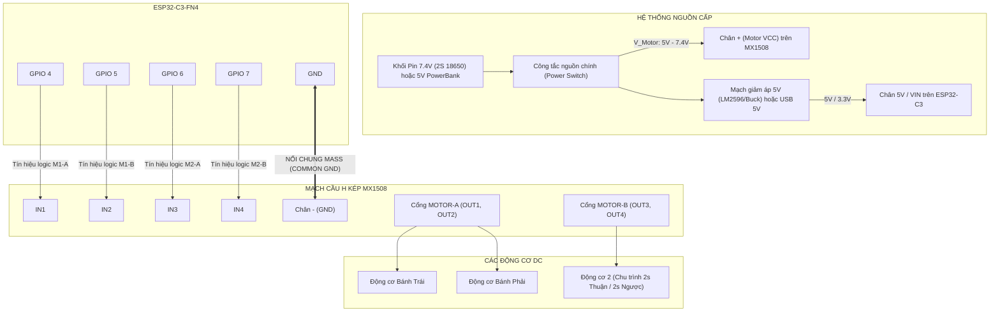

# SƠ ĐỒ MÔ HÌNH MẠCH VÀ KẾT NỐI PHẦN CỨNG
**Dự án:** Điều khiển 2 động cơ độc lập qua Bluetooth Low Energy (Adafruit Bluefruit LE Connect)  
**Vi điều khiển:** ESP32-C3-FN4 (Flash 4MB)  
**Mạch công suất:** Driver cầu H kép MX1508 (Dual DC Motor Driver)

---

## 1. SƠ ĐỒ KHỐI HỆ THỐNG (MERMAID DIAGRAM)



---

## 2. BẢNG ĐẤU NỐI DÂY CHI TIẾT (WIRING TABLE)

### 2.1. Tín hiệu điều khiển (ESP32-C3 <-> MX1508)

| Chân ESP32-C3 | Chân MX1508 | Chức năng điều khiển | Ghi chú |
| :--- | :--- | :--- | :--- |
| **GPIO 4** | **IN1** | Chiều thuận Motor 1 (Tiến) | Hỗ trợ xung PWM điều tốc |
| **GPIO 5** | **IN2** | Chiều ngược Motor 1 (Lùi) | Hỗ trợ xung PWM điều tốc |
| **GPIO 6** | **IN3** | Chiều thuận Motor 2 | Quay 2 giây đầu |
| **GPIO 7** | **IN4** | Chiều ngược Motor 2 | Đảo chiều quay 2 giây sau |
| **GND** | **- (GND)** | **Mass chung (Common Ground)** | **BẮT BUỘC phải nối chung** |

---

### 2.2. Kết nối Động cơ (MX1508 <-> Motors)

| Cổng ra MX1508 | Thiết bị kết nối | Mô tả hoạt động |
| :--- | :--- | :--- |
| **MOTOR-A** (2 chân) | **2 Động cơ Bánh xe** (Đấu song song cùng chiều) | Điều khiển xe di chuyển **Tiến** hoặc **Lùi** |
| **MOTOR-B** (2 chân) | **Động cơ 2** (Động cơ chức năng) | Nhấn nút -> Tự động quay thuận **2 giây** -> Đảo chiều **2 giây** -> Tự động dừng |

> [!TIP]
> **Đấu song song 2 bánh xe ở Motor 1:**  
> Nối cực dương (+) của động cơ bánh trái với cực dương (+) của động cơ bánh phải vào cùng 1 cọc ra của cổng MOTOR-A. Tương tự, nối 2 cực âm (-) vào cọc ra còn lại. Nếu 1 bánh bị quay ngược chiều với bánh kia, chỉ cần đảo 2 dây của riêng bánh đó.

---

### 2.3. Kết nối Nguồn điện (Power Supply)

| Nguồn cấp | Cực dương (+) | Cực âm (-) | Lưu ý kỹ thuật |
| :--- | :--- | :--- | :--- |
| **Nguồn Động cơ** | Nối vào chân **+** của MX1508 (2V - 9.6V) | Nối vào chân **-** của MX1508 | Khuyên dùng 2 cell 18650 (7.4V) hoặc nguồn 5V riêng biệt có dòng tối thiểu 2A. |
| **Nguồn ESP32-C3** | Nối vào chân **5V (VIN)** của ESP32-C3 | Nối vào chân **GND** của ESP32-C3 | Lấy từ mạch giảm áp (Buck 5V) hoặc cắm cáp USB Type-C trực tiếp. |
| **Liên kết Mass** | — | **Nối tắt GND của ESP32 với chân (-) của MX1508** | **Không có liên kết này, tín hiệu điều khiển sẽ bị nhiễu hoặc motor không chạy.** |

---

## 3. SƠ ĐỒ MẠCH TRỰC QUAN (ASCII SCHEMATIC)

```text
                +---------------------------------------+
                |           KHỐI PIN NGUỒN              |
                |  (2x Pin 18650 = 7.4V hoặc Pin 5V)   |
                +-------------------+-------------------+
                                    | (+) 7.4V
                                    +--------------+
                                    |              |
                                  [Công tắc]       |
                                    |              |
                                    v              v
                              +-----------+   +----------+
                              | Hạ áp 5V  |   | Chân (+) |
                              | (LM2596/  |   |  MX1508  |
                              |   Buck)   |   +----+-----+
                              +-----+-----+        |
                                    | 5V           |
                                    |              |
      +-----------------------------+              |
      |                                            |
      v                                            v
+------------------------+            +-------------------------+
|   ESP32-C3-FN4         |            |      DRIVER MX1508      |
|                        |            |                         |
|   [5V / VIN] <---------+            |  (+) VCC [ 2V - 9.6V ]  |
|                        |            |  (-) GND                |
|   [GPIO 4] ------------+----------->|  IN1 (Motor 1 FWD)      |
|   [GPIO 5] ------------+----------->|  IN2 (Motor 1 REV)      |
|   [GPIO 6] ------------+----------->|  IN3 (Motor 2 FWD)      |
|   [GPIO 7] ------------+----------->|  IN4 (Motor 2 REV)      |
|                        |            |                         |
|   [GND] ---------------+----------->|  (-) GND                |
+------------------------+      |     +----+---------------+----+
                                |          |               |
                         (NỐI CHUNG MASS)  | MOTOR-A       | MOTOR-B
                                           |               |
                                     +-----+-----+   +-----+-----+
                                     |           |   |           |
                                     v           v   v           v
                              +-------------+  +-------------+
                              | ĐỘNG CƠ 1   |  | ĐỘNG CƠ 2   |
                              | (2 Bánh xe) |  | (Quay 2s    |
                              | Tiến / Lùi  |  |  Đảo chiều) |
                              +-------------+  +-------------+
```

---

## 4. NGUYÊN LÝ ĐIỀU KHIỂN & BẢNG CHÂN TRỊ (TRUTH TABLE)

### Động cơ 1 (Bánh xe)
| Trạng thái | IN1 (GPIO 4) | IN2 (GPIO 5) | Hoạt động của Motor 1 |
| :--- | :---: | :---: | :--- |
| **Tiến (Forward)** | `HIGH` (hoặc PWM) | `LOW` (0) | Cả 2 bánh xe quay tiến |
| **Lùi (Backward)** | `LOW` (0) | `HIGH` (hoặc PWM) | Cả 2 bánh xe quay lùi |
| **Dừng quán tính (Coast)** | `LOW` (0) | `LOW` (0) | Động cơ nhả tự do, dừng êm |
| **Thắng phanh (Brake)** | `HIGH` (255) | `HIGH` (255) | Khóa ngắn mạch động cơ, phanh gấp |

### Động cơ 2 (Chu trình tự động 2s Thuận -> 2s Ngược)
| Giai đoạn | IN3 (GPIO 6) | IN4 (GPIO 7) | Thời gian | Hoạt động |
| :--- | :---: | :---: | :---: | :--- |
| **Trạng thái chờ** | `LOW` | `LOW` | Vô hạn | Động cơ nghỉ |
| **Pha 1: Quay thuận** | `HIGH` (PWM) | `LOW` | **Đúng 2.0 giây** | Động cơ 2 quay chiều thuận |
| **Pha 2: Quay ngược** | `LOW` | `HIGH` (PWM) | **Đúng 2.0 giây** | Tự động đảo chiều quay ngược |
| **Kết thúc** | `LOW` | `LOW` | — | Tự động ngắt điện, về trạng thái chờ |

---

## 5. CÁC LƯU Ý KỸ THUẬT VÀ PHÒNG CHỐNG NHIỄU (BẮT BUỘC ĐỌC)

> [!WARNING]
> **Hiện tượng sụt áp (Brownout Reset):**  
> Khi động cơ DC khởi động hoặc đảo chiều đột ngột, dòng khởi động có thể tăng vọt gấp 3-5 lần bình thường. Nếu dùng chung nguồn nuôi ESP32-C3 mà không lọc, điện áp cấp cho ESP32 sẽ bị sụt dưới 2.8V, làm ESP32 tự reset lại (báo lỗi *Brownout detector was triggered*).

### Biện pháp xử lý tối ưu:
1. **Nguồn cấp độc lập hoặc nguồn có dòng lớn:**  
   - Khuyên dùng 2 cell pin 18650 mắc nối tiếp (7.4V) qua mạch hạ áp Buck LM2596 (chỉnh ra 5V nuôi ESP32-C3), còn đường 7.4V cấp trực tiếp vào chân (+) của MX1508.
   - Hoặc cấp nguồn ESP32-C3 bằng sạc dự phòng qua cổng Type-C, còn pin riêng nuôi MX1508 (nhớ nối chung dây âm GND!).
2. **Thêm tụ lọc nguồn tại chân MX1508:**  
   - Hàn 1 tụ hóa **100µF – 470µF (16V/25V)** song song giữa chân (+) và chân (-) của MX1508.
   - Mắc thêm 1 tụ gốm **100nF (104)** song song để dập xung gai điện áp cao tần.
3. **Triệt tiêu tia lửa điện chổi than trên động cơ DC:**  
   - Hàn 1 tụ gốm **104 (100nF)** ngay trên 2 cực của mỗi động cơ DC. Tụ này có tác dụng triệt tiêu sóng hài tia lửa điện chổi than, tránh làm nhiễu sóng Bluetooth BLE của ESP32-C3.
