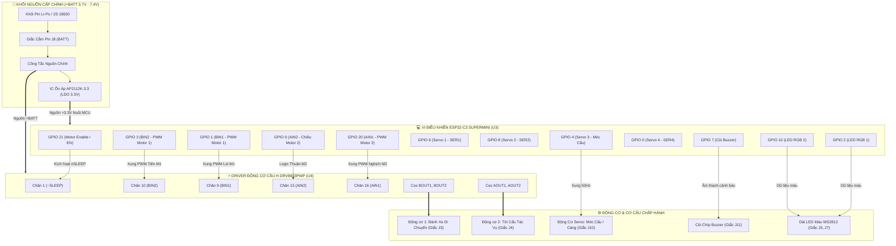

# SƠ ĐỒ NGUYÊN LÝ MẠCH & KẾT NỐI PHẦN CỨNG - LV4CRANE

Tài liệu kỹ thuật giải thích chi tiết sơ đồ đấu nối phần cứng dựa trên tệp thiết kế mạch KiCad [Shield.kicad_sch](file:///d:/CyberBricked/Crane/Shield.kicad_sch) của hệ sinh thái **CyberBricked**.

- **Vi điều khiển trung tâm (U3):** ESP32-C3 SuperMini SMD (32-bit RISC-V, BLE 5.0, Native USB CDC).
- **Mạch công suất động cơ (U4):** DRV8833PWP Dual H-Bridge (Dòng đỉnh 2A mỗi kênh, điện áp 2.7V - 10.8V).
- **IC Ổn áp nguồn 3.3V (U1):** AP2112K-3.3 (Dòng ra cực đại 600mA, độ sụt áp siêu thấp LDO).

---

## 1. Sơ Đồ Khối Toàn Hệ Thống (System Architecture Diagram)



---

## 2. Bảng Đấu Nối Chân Chi Tiết Từ Sơ Đồ Nguyên Lý KiCad

| GPIO ESP32-C3 | Nhãn Net KiCad | Linh Kiện / Chân IC Kết Nối | Tên Giắc Cắm | Mô Tả Chức Năng |
| :--- | :--- | :--- | :--- | :--- |
| **GPIO 21** | `EN` | Chân 1 (`~SLEEP`) của DRV8833 (U4) | Bo mạch Shield | **Kích hoạt công suất:** Mức `HIGH` đánh thức DRV8833, `LOW` đưa driver vào chế độ ngủ tiết kiệm pin. |
| **GPIO 3** | `BIN2` | Chân 10 (`BIN2`) của DRV8833 (U4) | Giắc Motor J3 | **Động cơ 1 - Chiều tiến:** Băm xung LEDC PWM Kênh 0 (1kHz, 8-bit). |
| **GPIO 1** | `BIN1` | Chân 9 (`BIN1`) của DRV8833 (U4) | Giắc Motor J3 | **Động cơ 1 - Chiều lùi:** Băm xung LEDC PWM Kênh 1 (1kHz, 8-bit). |
| **GPIO 9** | `AIN2` | Chân 15 (`AIN2`) của DRV8833 (U4) | Giắc Motor J4 | **Động cơ 2 - Chiều thuận:** Chân BOOT trên ESP32-C3; dùng kỹ thuật kéo trở pull-up 10k an toàn. |
| **GPIO 20** | `AIN1` | Chân 16 (`AIN1`) của DRV8833 (U4) | Giắc Motor J4 | **Động cơ 2 - Chiều nghịch:** Băm xung LEDC PWM Kênh 2 (1kHz, 8-bit). |
| **GPIO 4** | `SER3` | Chân 5 của Giắc Cắm J10 | Giắc Servo J10 | **Cơ cấu móc cẩu:** Xuất xung Servo tiêu chuẩn 50Hz (500µs - 2400µs). |
| **GPIO 0** | `SER4` | Chân 6 của Giắc Cắm J10 | Giắc Servo J10 | **Servo 4 mở rộng:** Dùng cho cơ cấu phụ (kẹp, gắp, gạt). |
| **GPIO 6** | `SER1` | Chân 5 của Giắc Cắm J9 | Giắc Servo J9 | **Servo 1:** Kênh servo tốc độ cao (ở xe tăng dùng để nâng nòng). |
| **GPIO 8** | `SER2` | Chân 6 của Giắc Cắm J9 | Giắc Servo J9 | **Servo 2:** Kênh servo cơ cấu bắn đạn. |
| **GPIO 7** | `Buzz` | Chân 1 của Giắc Cắm J11 | Giắc Còi J11 | **Còi Buzzer:** Phát tiếng bíp báo trạng thái kết nối hoặc còi xe. |
| **GPIO 2** | `RGB1` | Chân 1 của Giắc Cắm J7 | Giắc LED J7 | **Đèn LED RGB 1:** Chuẩn tín hiệu WS2812 (Đèn trước xe). |
| **GPIO 10** | `RGB2` | Chân 1 của Giắc Cắm J5 | Giắc LED J5 | **Đèn LED RGB 2:** Chuẩn tín hiệu WS2812 (Đèn sau xe). |
| **GPIO 18 / 19** | `D-` / `D+` | Cổng kết nối USB Type-C (USB1) | Cổng nạp USB | Giao tiếp nạp code và theo dõi USB Serial CDC. |
| **GPIO 5** | *(Trống)*| Không định tuyến ra ngoại vi | Shield | Chân dự phòng tự do (`SPARE`). |

---

## 3. Chi Tiết Các Đầu Cắm Ngoại Vi Trên Bo Mạch Shield

### 3.1. Cụm Giắc Cắm Động Cơ Servo (J9 và J10)

Giắc cắm chuẩn 3 chân (GND, +5V, Signal) xếp đôi `Conn_02x03_Odd_Even`:

```text
Giắc J9 (Servo 1 & 2):               Giắc J10 (Servo 3 & 4):
  Pin 1: GND    Pin 2: GND             Pin 1: GND    Pin 2: GND
  Pin 3: +5V    Pin 4: +5V             Pin 3: +5V    Pin 4: +5V
  Pin 5: SER1   Pin 6: SER2            Pin 5: SER3   Pin 6: SER4
  (GPIO 6)      (GPIO 8)               (GPIO 4)      (GPIO 0)
```

### 3.2. Cụm Giắc Động Cơ DC (J3 và J4)
- **Giắc J3 (Motor 1 - Bánh xe):** Nối ra cọc `BOUT1` và `BOUT2` của DRV8833.
- **Giắc J4 (Motor 2 - Tời cẩu):** Nối ra cọc `AOUT1` và `AOUT2` của DRV8833.

---

## 4. Lưu Ý Kỹ Thuật Quan Trọng Về Phần Cứng

1. **Chân GPIO 9 (Nút BOOT ESP32-C3):**
   - Trên bo ESP32-C3 SuperMini, chân GPIO 9 là chân nút nhấn BOOT và được gắn sẵn điện trở kéo lên nguồn ($10\text{k}\Omega$ Pull-up lên 3.3V).
   - Mã nguồn trong [motor_driver.cpp](file:///d:/CyberBricked/lv4Crane/src/motor_driver.cpp) đã tích hợp hàm `gpio_reset_pin(GPIO_NUM_9)` để giải phóng chức năng JTAG mặc định của ROM Bootloader, đồng thời hàm `pinHigh(9)` dùng chế độ `pinMode(pin, INPUT_PULLUP)` để kích hoạt trạng thái logic cao chuẩn xác mà không gây sụt áp boot.
2. **Kích hoạt Driver qua GPIO 21:**
   - Chân `~SLEEP` (Pin 1) của DRV8833 là ngõ vào tích cực thấp. Bắt buộc phải xuất mức `HIGH` trên GPIO 21 (`digitalWrite(MOTOR_ENABLE_PIN, HIGH)`) thì cầu H mới bắt đầu dẫn dòng ra động cơ.
