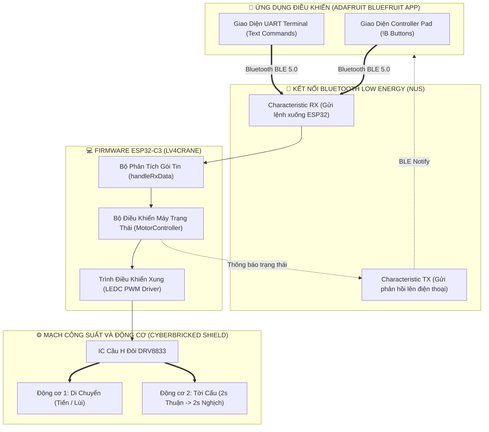
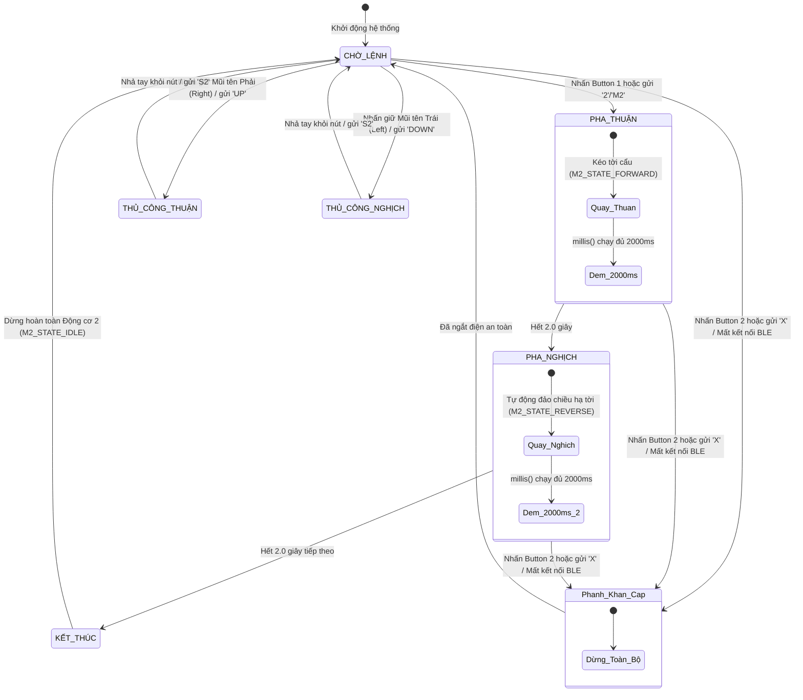
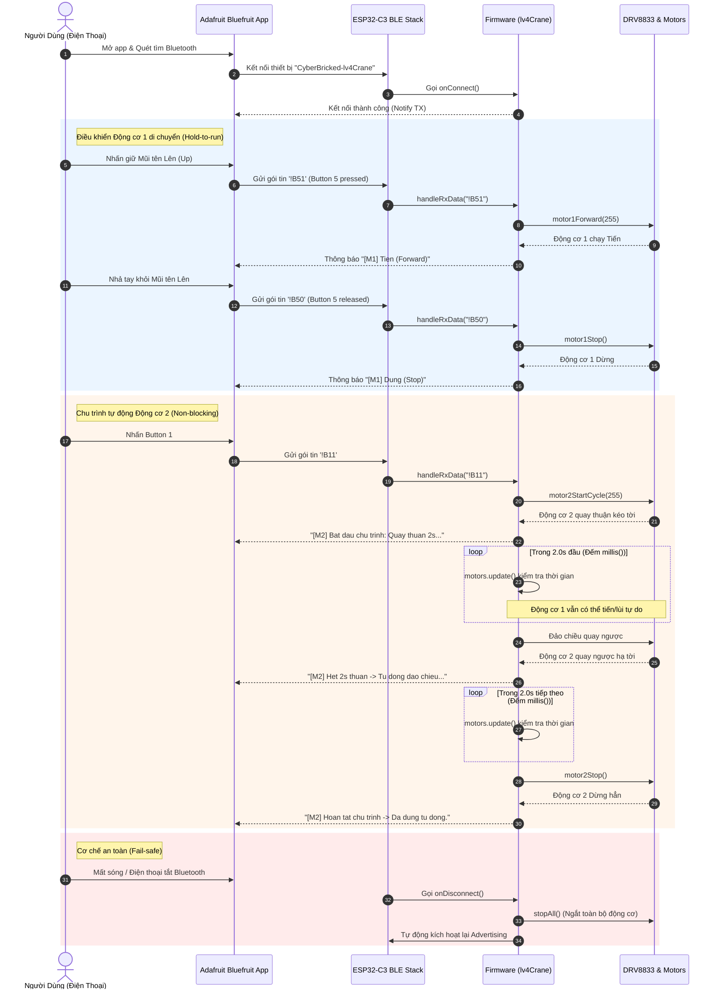

# lv4Crane - Điều Khiển Cần Cẩu CyberBricked Qua BLE (Logic std_ble_2m)

Dự án firmware dành cho robot cần cẩu **lv4Crane** tích hợp phần cứng của hệ sinh thái **CyberBricked** (vi điều khiển **ESP32-C3-DevKitM-1** kết hợp mạch công suất cầu H đôi **DRV8833**) nhưng sử dụng chuẩn giao thức điều khiển và logic máy trạng thái non-blocking từ dự án **std_ble_2m** qua ứng dụng **Adafruit Bluefruit LE Connect**.

---

## 🚀 Tính Năng Chính

1. **Phần cứng chuẩn CyberBricked (KiCad Shield):**
   - **Chip:** ESP32-C3 SuperMini / DevKitM-1 (kiến trúc RISC-V, BLE 5.0, Native USB CDC).
   - **Motor Driver:** DRV8833 Dual H-Bridge với chân kích hoạt `MOTOR_ENABLE_PIN = GPIO 21` (`~SLEEP`).
   - **Xử lý chân BOOT:** Chân `MOTOR_B_IN1` (GPIO 9) được thiết lập reset ngoại vi và dùng cơ chế pull-up an toàn, bảo đảm tương thích 100% với Shield CyberBricked.
   - **Hỗ trợ đầy đủ cổng Servo:** Tích hợp định nghĩa chân chuẩn cho 4 cổng servo (`GPIO 6`, `GPIO 8`, `GPIO 4`, `GPIO 0`), còi Buzzer (`GPIO 7`) và LED RGB WS2812 (`GPIO 2`, `GPIO 10`).
2. **Logic điều khiển chuẩn dự án `std_ble_2m`:**
   - **Động cơ 1 (Motor A - Bánh xe di chuyển / Trục chính):**
     - Phím **Mũi tên Lên (Up)**: Nhấn giữ xe chạy **Tiến**, nhả tay xe tự **Dừng** (Hold-to-run).
     - Phím **Mũi tên Xuống (Down)**: Nhấn giữ xe chạy **Lùi**, nhả tay xe tự **Dừng** (Hold-to-run).
   - **Động cơ 2 (Motor B - Tời cẩu / Cơ cấu tác vụ):**
     - **Chế độ tự động (Button 1 hoặc lệnh `2`/`M2`):** Tự động quay thuận kéo tời trong **2.0 giây** $\rightarrow$ Tự động đảo chiều quay ngược hạ tời trong **2.0 giây** $\rightarrow$ Tự động dừng hẳn.
     - **Chế độ thủ công (Mũi tên Trái / Phải hoặc lệnh `UP` / `DOWN` / `S2`):** Nhấn giữ để kéo hoặc hạ tời cẩu chủ động.
     - **Thuật toán Non-blocking:** Toàn bộ chu trình sử dụng máy trạng thái với `millis()`, hoàn toàn không dùng hàm `delay()`. Do đó Động cơ 1 vẫn tiến/lùi mượt mà trong khi Động cơ 2 đang thực thi chu trình tự động.
   - **Cơ chế an toàn (Fail-safe):** Khi ngắt kết nối BLE hoặc điện thoại ra khỏi vùng phát sóng, hệ thống lập tức ngắt toàn bộ động cơ (`stopAll()`) và tự động bật lại chế độ quảng bá (Advertising) để chờ kết nối lại.
   - **Phản hồi thời gian thực (BLE TX Feedback):** Mọi thao tác đều được gửi thông báo trạng thái tức thời về điện thoại qua BLE Notify.

---

## 📊 Biểu Đồ Hệ Thống & Lưu Đồ Hoạt Động (Mermaid Diagrams)

### 1. Kiến Trúc Tổng Quan (System Architecture)



---

### 2. Máy Trạng Thái Non-Blocking Động Cơ 2 (State Machine Diagram)



---

### 3. Trình Tự Giao Tiếp BLE (Sequence Diagram)



---

## 🔌 Bảng Đấu Nối Phần Cứng Chuẩn KiCad (`Shield.kicad_sch`)

Chi tiết mô hình mạch điện xem tại: [CIRCUIT_DIAGRAM.md](file:///d:/CyberBricked/lv4Crane/CIRCUIT_DIAGRAM.md)

| Chân ESP32-C3 | Nhãn Net KiCad | Chân IC / Đầu Nối | Chức Năng Trên Bo Mạch | Ghi Chú Kỹ Thuật |
| :--- | :--- | :--- | :--- | :--- |
| **GPIO 21** | `EN` | Pin 1 (`~SLEEP`) của DRV8833 | Bo Shield | **Kích hoạt công suất:** Kéo mức `HIGH` để đánh thức driver DRV8833. |
| **GPIO 3** | `BIN2` | Pin 10 (`BIN2`) của DRV8833 | Giắc Motor J3 | **Động cơ 1 - Chiều tiến:** Xung PWM LEDC Kênh 0 (1kHz, 8-bit). |
| **GPIO 1** | `BIN1` | Pin 9 (`BIN1`) của DRV8833 | Giắc Motor J3 | **Động cơ 1 - Chiều lùi:** Xung PWM LEDC Kênh 1 (1kHz, 8-bit). |
| **GPIO 9** | `AIN2` | Pin 15 (`AIN2`) của DRV8833 | Giắc Motor J4 | **Động cơ 2 - Chiều thuận:** Chân BOOT trên ESP32-C3; kéo pull-up an toàn. |
| **GPIO 20** | `AIN1` | Pin 16 (`AIN1`) của DRV8833 | Giắc Motor J4 | **Động cơ 2 - Chiều nghịch:** Xung PWM LEDC Kênh 2 (1kHz, 8-bit). |
| **GPIO 4** | `SER3` | Chân 5 Giắc J10 | Giắc Servo J10 | **Cơ cấu móc cẩu:** Tín hiệu điều khiển Servo 50Hz (Chân 5 Giắc J10). |
| **GPIO 0** | `SER4` | Chân 6 Giắc J10 | Giắc Servo J10 | **Servo 4 mở rộng:** Tín hiệu Servo 4. |
| **GPIO 6** | `SER1` | Chân 5 Giắc J9 | Giắc Servo J9 | **Servo 1 mở rộng:** Tín hiệu Servo 1. |
| **GPIO 8** | `SER2` | Chân 6 Giắc J9 | Giắc Servo J9 | **Servo 2 mở rộng:** Tín hiệu Servo 2. |
| **GPIO 7** | `Buzz` | Chân 1 Giắc J11 | Giắc Còi J11 | **Còi Buzzer:** Âm thanh bíp / còi xe. |
| **GPIO 2** | `RGB1` | Chân 1 Giắc J7 | Giắc LED J7 | **Đèn LED RGB 1:** Chuẩn tín hiệu WS2812. |
| **GPIO 10** | `RGB2` | Chân 1 Giắc J5 | Giắc LED J5 | **Đèn LED RGB 2:** Chuẩn tín hiệu WS2812. |
| **GPIO 18 / 19** | `D-` / `D+` | Chân D- / D+ Cổng Type-C | Cổng Type-C | Giao tiếp nạp code và USB Serial CDC. |
| **GPIO 5** | — | Chân tự do | Bo Shield | Dự phòng (`SPARE`). |

---

## 📱 Hướng Dẫn Điều Khiển Trên App Adafruit Bluefruit LE Connect

1. Tải ứng dụng **Adafruit Bluefruit LE Connect** trên [App Store (iOS)](https://apps.apple.com/app/adafruit-bluefruit-le-connect/id830125974) hoặc [Google Play (Android)](https://play.google.com/store/apps/details?id=com.adafruit.bluefruit.le.connect).
2. Bật Bluetooth trên điện thoại, mở app và kết nối với thiết bị: **`CyberBricked-lv4Crane`**.
3. **Cách 1: Giao diện Controller -> Control Pad (Phím bấm):**
   - ⬆️ **Mũi tên Lên (Up):** Nhấn giữ Động cơ 1 **Tiến**, nhả tay xe tự **Dừng**.
   - ⬇️ **Mũi tên Xuống (Down):** Nhấn giữ Động cơ 1 **Lùi**, nhả tay xe tự **Dừng**.
   - ⬅️ **Mũi tên Trái (Left):** Nhấn giữ Động cơ 2 **Hạ tời cẩu**, nhả tay tự **Dừng**.
   - ➡️ **Mũi tên Phải (Right):** Nhấn giữ Động cơ 2 **Kéo tời cẩu**, nhả tay tự **Dừng**.
   - 🔘 **Button 1:** Kích hoạt chu trình Động cơ 2 tự động: **Quay thuận 2s $\rightarrow$ Quay ngược 2s $\rightarrow$ Tự dừng**.
   - 🔘 **Button 2:** Phanh dừng khẩn cấp toàn bộ động cơ (`stopAll`).
4. **Cách 2: Giao diện UART Terminal (Dòng lệnh):**
   - Gửi `F` hoặc `TIEN`: Động cơ 1 Tiến.
   - Gửi `B` hoặc `LUI`: Động cơ 1 Lùi.
   - Gửi `S` hoặc `DUNG`: Động cơ 1 Dừng.
   - Gửi `2` hoặc `M2`: Chạy chu trình tự động Động cơ 2.
   - Gửi `UP` hoặc `TOI_LEN`: Động cơ 2 Kéo tời.
   - Gửi `DOWN` hoặc `TOI_XUONG`: Động cơ 2 Hạ tời.
   - Gửi `S2`: Động cơ 2 Dừng.
   - Gửi `X` hoặc `STOP`: Dừng khẩn cấp toàn bộ hệ thống.

---

## 🛠️ Biên Dịch & Nạp Code Với PlatformIO

```powershell
# 1. Biên dịch mã nguồn:
pio run -d d:\CyberBricked\lv4Crane

# 2. Cắm cáp USB-C và nạp code vào ESP32-C3:
pio run -d d:\CyberBricked\lv4Crane -t upload

# 3. Mở Serial Monitor theo dõi log hệ thống (115200 baud):
pio device monitor
```
